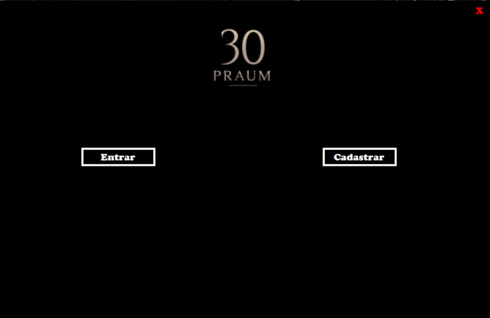
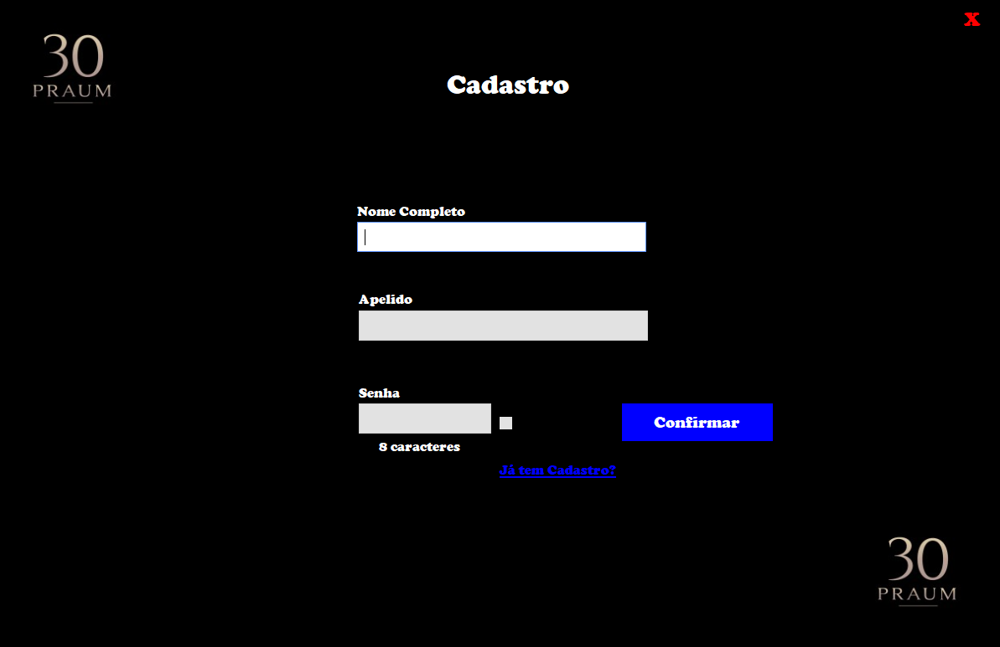
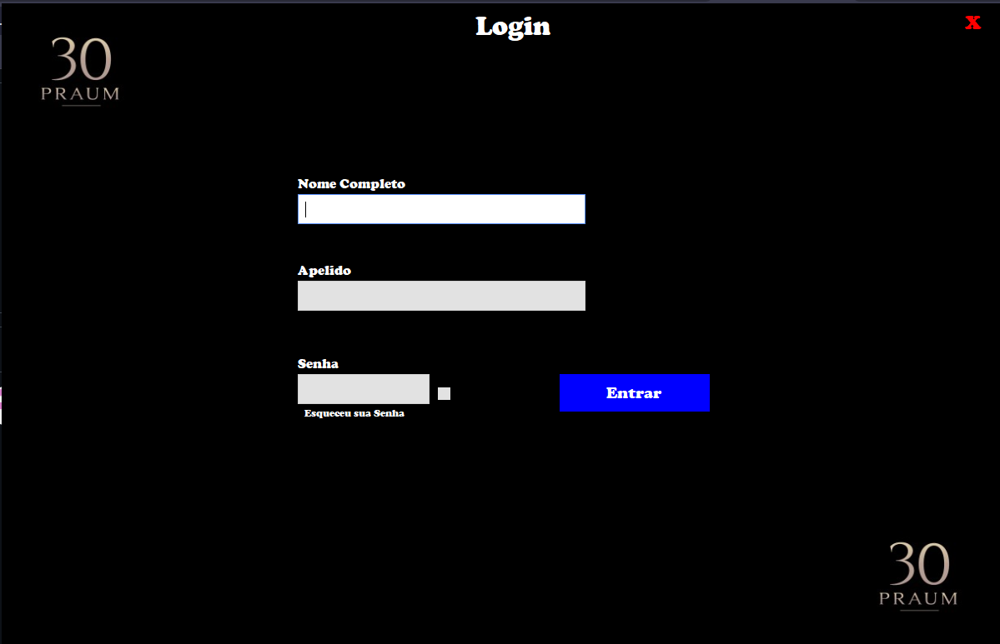
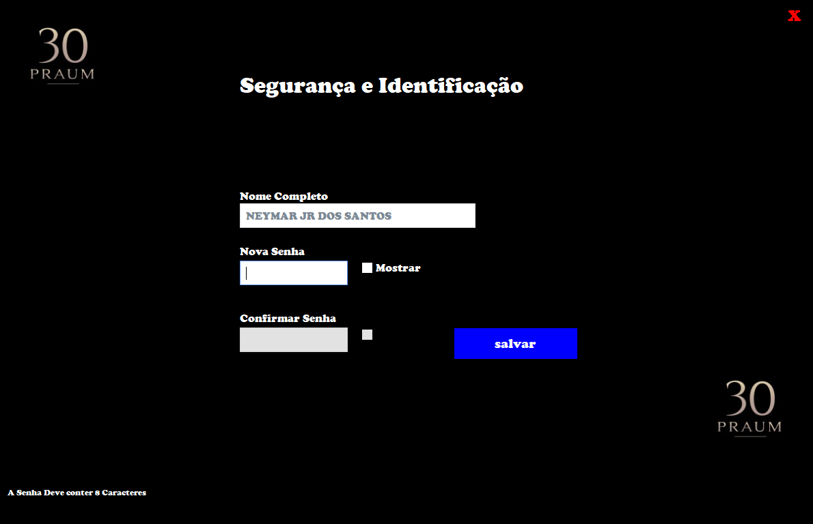
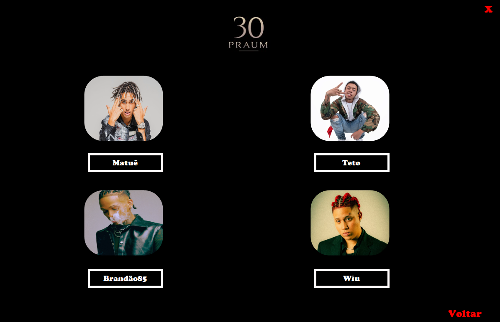
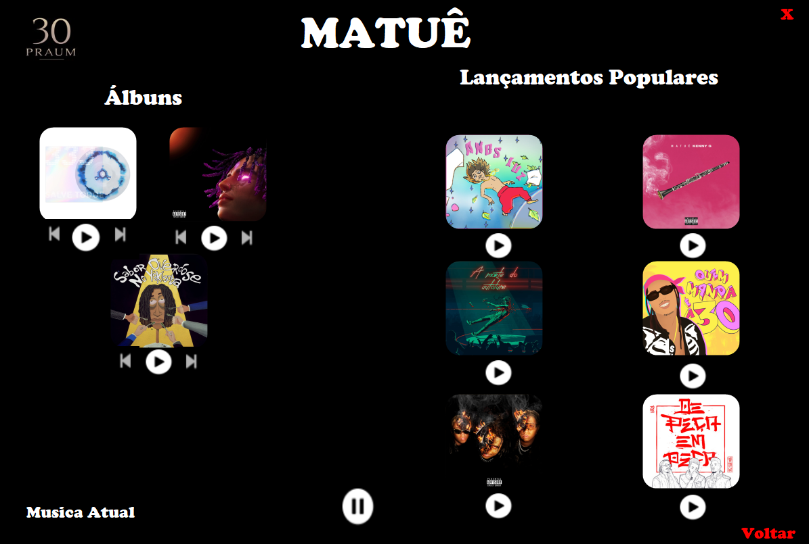

# 30Praum

Aplicação desktop de música da gravadora 30Praum, integrada a um banco de dados MySQL. O sistema exige cadastro e login e permite a redefinição de senha. Após autenticar-se, o usuário escolhe um artista e reproduz seus álbuns e lançamentos populares.

## Funcionalidades

- Cadastro de usuário (nome completo, apelido e senha de 8 caracteres)
- Login e redefinição de senha
- Seleção de artistas: Matuê, Teto, Brandão85 e Wiu
- Página de cada artista com álbuns e lançamentos populares
- Controles de reprodução (play, pause, anterior e próxima) e exibição da música atual

## Telas

## Tecnologias

- C# (.NET Framework 4.7.2)
- Windows Forms
- MySQL (biblioteca MySql.Data)
- Windows Media Player (reprodução de áudio)

## Como rodar

**Requisitos:** Windows, Visual Studio com a carga de trabalho de desenvolvimento para desktop com .NET, XAMPP (MySQL) e Windows Media Player.

1. Clone este repositório.
2. Inicie o MySQL pelo XAMPP e acesse o phpMyAdmin.
3. Crie o banco `bd_usuarios` (caso o script ainda não o crie) e importe o arquivo `.sql` da pasta `banco de daos`.
4. Abra o arquivo `projeto final 30Praum.sln` no Visual Studio. Os pacotes NuGet são restaurados automaticamente ao compilar.
5. Crie a pasta `audios` dentro de `bin\Debug` e coloque nela as músicas em formato `.mp3` usadas pelo programa (não incluídas no repositório).
6. Execute o projeto.

A conexão usa `localhost`, usuário `root` e sem senha (padrão do XAMPP). Se o seu MySQL tiver senha, ajuste a string de conexão no arquivo `Banco.cs`.

## Observação

Projeto desenvolvido para fins educacionais, sem fins lucrativos. As músicas, capas e imagens dos artistas pertencem aos seus respectivos detentores.

## Autor

Desenvolvido por Muslih Sabino Suleiman.
